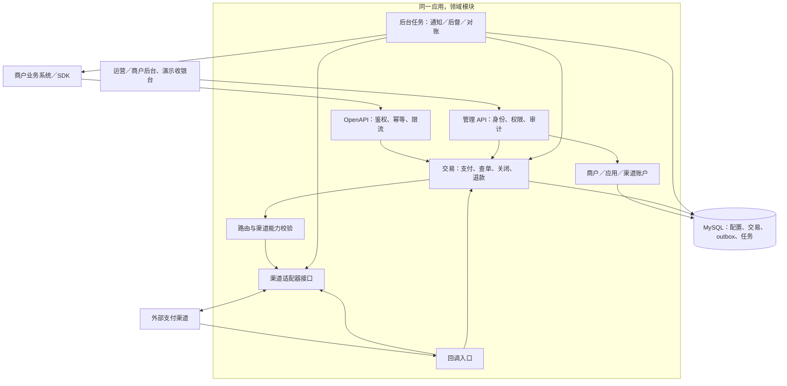

# 支付系统 v2：all-in-one 架构草案

日期：2026-10-21。状态：供评审的初始提案；目录、接口和表均为目标设计，尚未实现。

## 1. 目标与范围假设

用户明确要求：以 `pjoc-team/pay-gateway` 为基础，在 `v2` 分支重构成大仓 all-in-one 三方支付系统；先导入并阅读历史文档，然后设计。

本提案将 all-in-one 理解为：协议、交易核心、渠道适配器、后台、SDK、数据库迁移、开发与部署资产在同一仓库维护；默认一个应用进程配合 MySQL 即可运行。可选拆出 worker，但不要求每个领域部署微服务。

业务定位暂按“商户接入外部支付渠道的技术平台”设计。商品定价、优惠券、库存、发货仍由业务系统负责；收银台提供支付演示与接入体验。涉及余额、代理分润和出款的能力分阶段独立设计，不将历史名词表视为已确认需求。

首期建议交付商户应用与渠道配置、支付／查单／关闭、退款、渠道回调、商户通知、后督、基础对账、最小运营与商户后台。首个真实渠道由业务优先级决定，mock 用于离线验证。代理体系、签约代扣、多级分润、转账出款、资金账本分后续专题推进。

成功标准：本地一键启动；无需 etcd、Kafka 或数据库 RPC 即可完成 mock 支付闭环；重启不丢通知任务；重复请求和回调不会重复产生交易效果；未知结果可恢复；商户之间严格隔离。

## 2. 方案比较

| 方案 | 收益 | 代价 | 结论 |
| --- | --- | --- | --- |
| 模块化单体＋可选 worker | 本地事务清晰，部署简单，内部边界可测试，后续可拆服务 | 需通过依赖规则约束共享数据库与模块耦合 | 推荐 |
| 大仓内保留完整微服务 | 保留独立扩缩容与故障隔离 | 服务发现、RPC、分布式一致性和多进程启动成本仍在 | 有明确规模或地域需求后再引入 |
| 直接拼接现有网关和后台 | 初期迁移快 | 历史数据模型、协议与业务耦合继续累积 | 仅用于临时兼容入口 |

保留旧设计的渠道抽象和领域边界，将数据库服务、通知 RPC 等默认收敛成本地接口。单写主库保证交易事实，异步任务通过持久化机制达到最终一致；首期不采用跨地域双主写入。

## 3. 总体结构



API 与管理接口使用不同鉴权；同一制品可以承载全部功能，worker 可按进程角色独立启动。后台业务代码不直接访问交易表来修改支付状态。

## 4. 大仓组织与依赖方向

建议初期一个 Go module，沿用当前模块路径，避免迁移时同时引入模块版本路径变更。前端单独维护包清单；Go 工具链与依赖升级版本在实施准备阶段验证后固定。

```text
api/                    对外 OpenAPI、兼容协议与事件契约
cmd/pay/                装配入口；支持 all、api、worker 角色
internal/
  app/                  配置、生命周期与依赖装配
  merchant/             商户、应用、渠道绑定、权限范围
  payment/              订单、支付尝试、状态转换
  refund/               退款与额度预留
  channel/              能力接口、适配器注册、mock 与真实渠道
  notification/         商户通知与重试
  supervision/          主动查单与恢复任务
  reconciliation/       账单导入、核对、差错工单
  admin/                后台应用服务、身份授权、审计
  platform/             事务、任务存储、日志等基础设施
sdk/                    商户接入 SDK 与协议示例
web/                    运营／商户界面、演示收银台
migrations/             可追溯的数据库迁移
configs/                无密钥的示例配置
deploy/                Compose、镜像及后续 Kubernetes 资产
docs/                  历史快照、设计、接入和运维文档
```

模块对外暴露应用服务和端口接口；HTTP／存储／渠道 SDK 依赖领域接口，领域模型不依赖 protobuf、Gin、GORM 或 etcd。`platform` 只含技术设施，不能变成所有业务模型的共享包。共享数据库不授权跨模块任意写表；跨模块事务由应用用例协调，repository 必须绑定同一个事务上下文。

`pay-proto` 及后台仓库尚未导入。先列出实际使用资产、检查许可和生成流程，再将自有协议源文件与生成工具纳入大仓；避免只拷贝生成代码或整库搬入。`base-service`、`tracing` 逐项决定保留依赖或替换，首期无需把所有外部库内置。

## 5. 模块职责

| 模块 | 负责 | 主要依赖 |
| --- | --- | --- |
| merchant | 商户／应用、密钥版本、渠道账户授权、配置版本 | 配置存储、秘密引用、审计 |
| payment | 支付主单、尝试、统一状态转换、路由快照 | 渠道端口、交易存储、outbox |
| refund | 退款单、额度预留与释放、结果确认 | 已支付订单、渠道退款端口 |
| channel | 请求转换、验签／解密、统一结果、渠道 ACK 格式 | 渠道凭据只读视图、HTTP 客户端 |
| notification | 按事件通知商户、重试、人工重发 | outbox、通知任务、商户签名密钥 |
| supervision | 对未决尝试主动查单、关闭竞态处理 | payment 应用服务、持久化任务 |
| reconciliation | 渠道账单批次、支付／退款比对、差错 | 只读交易接口、账单适配器 |
| admin | 身份权限、查询、配置操作、审计 | 各领域应用服务 |

渠道接口按能力拆分为支付、查单、关闭、退款、退款查询、回调校验、账单下载等小接口；不支持的能力明确拒绝。适配器不保存订单、不决定商户业务成功，也不触发其他渠道的自动切换。

## 6. 交易模型与不变量

金额使用带币种的最小货币单位整数，建议 `int64` 且限制正数及安全上界，禁止浮点参与金额计算。币种小数位由配置约束，不能将所有币种统称“分”。费率使用明确分母的整数，例如百万分比，保存计费规则、费率版本和渠道账户快照；先舍入手续费，再用订单金额减手续费，确保金额守恒。

核心记录建议如下；索引和字段级 DDL 留待首期规格细化。

| 记录 | 关键约束 |
| --- | --- |
| merchants / applications / channel_accounts | 应用归属商户；凭据仅存加密值或秘密引用；所有渠道访问验证绑定权限 |
| payment_orders | `(app_id, merchant_order_no)` 非空唯一；金额、币种不可变；状态、版本可条件更新 |
| payment_attempts | 先落库，再发渠道请求；稳定的渠道商户订单号唯一；记录账户、配置快照、结果和查单任务 |
| refund_orders | `(app_id, merchant_refund_no)` 唯一；关联原支付尝试；成功额＋处理中预留额不得超过已支付金额 |
| channel_events | 渠道账户＋事件 ID 去重；无事件 ID 时使用已验证的标准化业务键与内容摘要 |
| outbox_events | 业务状态更新同事务追加；`event_id` 唯一；事件内容为版本化快照 |
| notification_jobs / task_jobs | 幂等任务键、下次执行时间、租约、尝试次数、错误、终态 |
| reconciliation_batches / differences | 渠道账户＋账单日期＋版本去重；差错与处置审计 |
| audit_logs | 操作人、租户、对象、变更摘要、关联请求 ID |

支付主单与支付尝试分离。首期每个订单只允许一个有效支付尝试，避免在结果未知时切换渠道形成多扣；进一步多尝试能力另做规格。成功主单保留在原表，不通过移表改变事实源。通知是否成功不属于支付状态。

支付状态建议：`CREATED → PROCESSING → SUCCEEDED / FAILED / CLOSED`。`PROCESSING` 中的尝试可标记结果未知，持续查单；超时、断网和进程退出均不是支付失败证据。`FAILED` 仅来自可验证的最终失败；`CLOSED` 需渠道确认未支付且已关闭。关闭请求与回调竞争时主动查单，确认成功则优先记录成功。若收到与终态冲突的可信信息，创建差错工单和核验任务，通过显式纠错流程处理，不直接覆盖。

退款独立状态为 `CREATED → PROCESSING → SUCCEEDED / FAILED`；处理中退款占用可退额度，失败才释放。部分退款不将支付主单改回未支付，支付状态与退款统计分开保存。

## 7. 支付、回调和失败恢复

### 创建支付

1. 验证应用身份、签名、时间窗和 nonce；校验金额、币种及回调地址。业务订单号提供业务幂等，nonce 负责防重放，两者用途不同。
2. 以应用＋商户订单号创建主单，保存请求摘要。重复且内容一致时返回已有交易和可用支付参数；金额／币种等冲突返回明确错误，不能创建新单。
3. 同一事务生成支付尝试、固定路由／账户／配置版本，并持久化后督任务；提交后再调用外部渠道，不持锁等待网络。
4. 使用稳定的渠道订单号调用渠道；结果以条件更新保存，避免慢响应把已由回调确认的成功覆盖为处理中。更新数据库失败时，后督从原有任务恢复。
5. 请求超时返回“处理中／结果未知”和可查询的订单号。客户端重试同一业务单号，服务端优先查已有尝试；渠道是否支持安全重发由适配器明确声明。

### 处理渠道回调

通过渠道与账户标识定位验签配置，保留原始请求字节以供验签／解密。验证事件关联的商户、渠道订单号、金额、币种、账户和真实支付状态；验签成功不等于支付成功。

在一个本地事务中去重事件、检查状态和版本、记录事实、更新订单、追加 outbox。提交成功后按渠道协议 ACK；重复且已处理的合法事件正常 ACK。持久化失败则返回可让渠道重试的失败响应。未知订单或语义不匹配事件隔离并告警，不能假装处理成功或据此直接结算。

### 通知商户

outbox 发布器持久化创建通知任务后才标记已分发；重复派发依靠唯一任务键去重。事件包含稳定 `event_id`、业务订单号、网关单号、金额、币种、事件类型和事件版本，并使用商户应用密钥签名。

采用至少一次投递；商户须按事件 ID 幂等处理。响应超时可能意味着商户已成功处理，重试仍使用相同事件 ID 与业务内容。重试采用有上限的指数退避和抖动，失败进入人工处理；人工重发保留同一事件 ID 并写审计。支付成功不受通知失败影响。

### 后督、对账与多实例

后督扫描已持久化的未决任务，通过原渠道账户查单，再调用统一状态转换服务。长时间未决进入告警和人工核验，不能仅因超过本地截止时间改成失败。

任务使用数据库原子认领与有限租约，多实例通过任务版本／租约令牌拒绝过期 worker 的完成更新；租约过期可重新执行。外部副作用仍依靠业务幂等键约束。进程关闭先停止接收和认领任务，再等待有限时间完成；崩溃后从数据库恢复。

对账按渠道账户、账单日期和渠道时区导入，检查文件完整性与重复导入，分别核对支付、退款、费用与金额。长短款和状态差异产生工单；账单差异先核验，不自动改余额或发起退款。后续资金结算和不可变复式账本必须另行设计，首期不以 `settlement` 包名宣称已有完整清算能力。

## 8. 协议与管理面

新接口建议以 `/api/v2` 为前缀，提供支付创建／查询／关闭、退款创建／查询；渠道回调使用独立命名空间。创建返回交易 ID、状态与版本化支付动作（如二维码／跳转／SDK 参数）；业务处理中与请求处理失败必须可区分。

错误至少区分参数错误、认证失败、无权限、幂等内容冲突、能力不支持、渠道明确拒绝、结果未知、暂时不可用；HTTP 与业务码映射在 API 规格中统一。请求、响应和事件源文件同仓管理，生成 SDK 时检查契约漂移。

旧协议只在兼容层转换 DTO 和错误码；所有交易仍走同一核心。是否兼容旧签名规则、字段、回调路径及 protobuf 必须以真实调用方契约测试决定。前端跳转不是支付成功证据，展示结果必须查服务端。

管理面采用一个前端工程按身份和权限呈现运营、商户视图；后端强制数据范围，不能仅靠隐藏菜单。商户可管理自己的应用、查询交易及通知；运营可管理渠道、查看差错和审计。代理组织、费率继承和跨层级数据范围在后续代理专题定义。退款、密钥修改、配置发布等操作具备独立权限与审计。

## 9. 运行、安全与可观测性

首期 MySQL 为交易事实与任务的唯一持久化依赖；配置可从文件／环境变量启动，商户与渠道业务配置入库并版本化。etcd、Redis、Kafka 不作为默认启动条件。需要时以缓存／消息传输适配器接入，不能替代交易事务与 outbox。

同一二进制支持一体运行、API 和 worker 角色；同一镜像用于开发与部署。前端构建产物可嵌入应用。Compose 提供应用＋数据库和 mock 演示；生产数据库备份、恢复演练、迁移控制及密钥注入独立管理。交易、回调和后督读取权威写库，避免复制延迟造成错误判断。

密钥不进入代码、示例或日志；渠道证书和密钥按版本轮换，旧交易与回调保留所需验证版本。商户通知 URL 限定 HTTPS 和授权域名，出站网络拒绝内网／元数据地址，验证解析结果并关闭或重新验证重定向，防止 SSRF。敏感报文脱敏、加密和保留期限需在实施规格中定义。

指标覆盖交易结果、渠道延迟／错误、未决订单年龄、outbox 积压、通知重试、任务租约和对账差错。日志关联 request／trace、应用、交易和事件 ID；指标标签避免使用订单号造成高基数。可用性、延迟、RPO／RTO 和容量数值在掌握现网数据后确定，当前不作无证据承诺。

## 10. 渐进迁移与验收

分阶段顺序是范围建议，不是已批准的实施计划：

1. 确认业务边界、首个渠道、协议兼容和部署目标，细化支付核心规格与契约测试。
2. 建立最小纵向闭环：商户应用、mock、下单、回调、通知、后督、一体启动；验证事务与故障恢复。
3. 接入首个真实渠道、退款及基础对账，完善最小运营／商户后台，演练备份恢复。
4. 按业务需要逐个设计签约代扣、代理计费、账本／结算、转账及更多渠道。

新旧系统按应用或商户灰度，主单记录路由归属；存量交易的回调、查单和退款固定回原系统，避免新旧双方重复发送渠道请求。先影子读取和对账校验，再切新单写入口；不双写两个支付核心。回滚只切未开始的新单，v2 已创建交易继续由 v2 完成生命周期。

验收必须覆盖：并发重复下单只产生一个有效尝试；相同单号不同金额被拒绝；回调与慢下单响应竞争不回退状态；事务回滚不留下半笔成功单；提交后崩溃仍可通知；通知重复投递不新增业务事件；重复退款和并发部分退款不超额；渠道超时后查单恢复；多 worker 租约失效可接管；商户越权被拒绝；账单重复导入无重复差错；旧协议契约及存量路由保持一致。

## 11. 评审需要确认的决策

以下为尚未确认的产品约束，不阻止阅读草案，但实施前应明确：

- all-in-one 是否接受“一个应用进程＋MySQL”的默认形态，还是需要保留分服务部署为主要形态。
- 首期是否采纳交易闭环优先；代理、代扣、转账、余额与资金结算分别何时纳入。
- 最先接入的真实渠道、商户自有／平台服务商账户模式，以及现有外部渠道实现所在仓库。
- v1 是否已在生产使用，需要兼容哪些 API／SDK、签名、表和存量交易。
- 目标用户、流量、部署地域、可用性与资金责任边界。

建议先确认默认运行形态与首期范围，再将最小交易闭环写为正式规格，评审后编写可执行实施计划。
